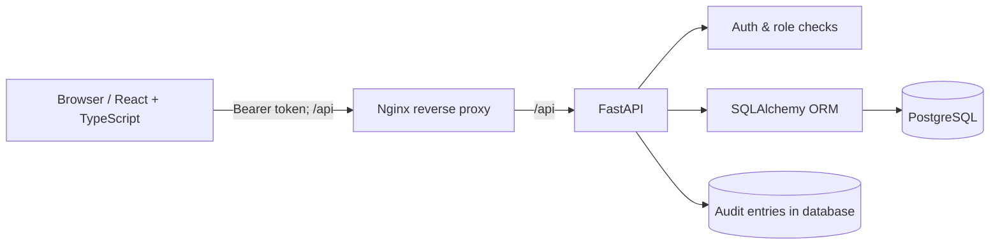
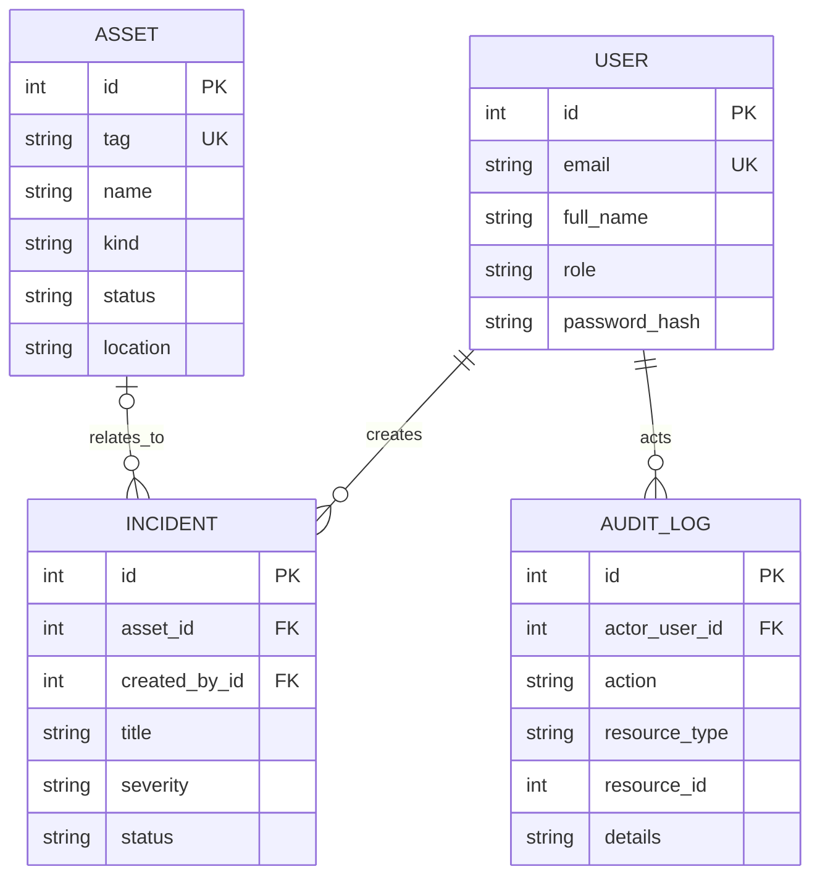

# Architecture and design decisions

## System overview

For local development, Vite proxies `/api` to the FastAPI process and SQLite can replace PostgreSQL.

## Data model

## Permission matrix

| Operation | Admin | Analyst | Viewer |
|---|---:|---:|---:|
| Sign in & read dashboard | ✅ | ✅ | ✅ |
| Read assets/incidents/audit | ✅ | ✅ | ✅ |
| Add or update assets/incidents | ✅ | ✅ | ❌ |
| Add users & list team | ✅ | ❌ | ❌ |

## Deliberate trade-offs

- Passwords use PBKDF2-HMAC-SHA256 with individual random salts and 600,000 iterations; access tokens are short-lived signed JWTs (HS256) without refresh tokens. Tokens are held **in browser memory**, not in localStorage, and browser reload requires login.
- Audit records are append-only **through the exposed API**. Database administrators can still alter them. For tamper resistance use external immutable logging and stronger privileged access restrictions.
- The example uses `create_all()` rather than migrations for simple setup; use Alembic for production schema evolution.
- The API uses offset/limit pagination and the UI displays the first 100 items. Real deployments should add cursor pagination, filters and server-side sorting.
- The service provides no password reset, account lockout, MFA, SSO, rate-limiting, external secrets store, or retention policy. **It is a learning portfolio app, not production-certified security software.**
- Docker Compose binds the demo to **127.0.0.1**, not a publicly accessible interface. Use a hardened HTTPS ingress, certificate management, WAF / abuse controls, backups, monitoring and a proper secrets manager before exposing publicly.
